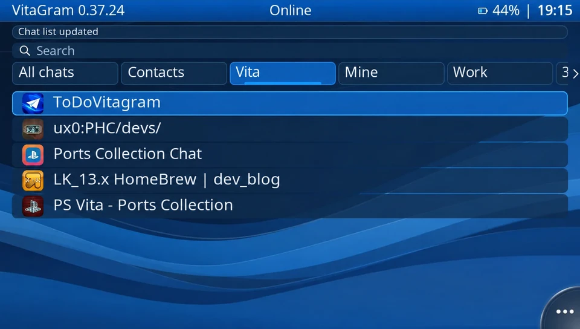
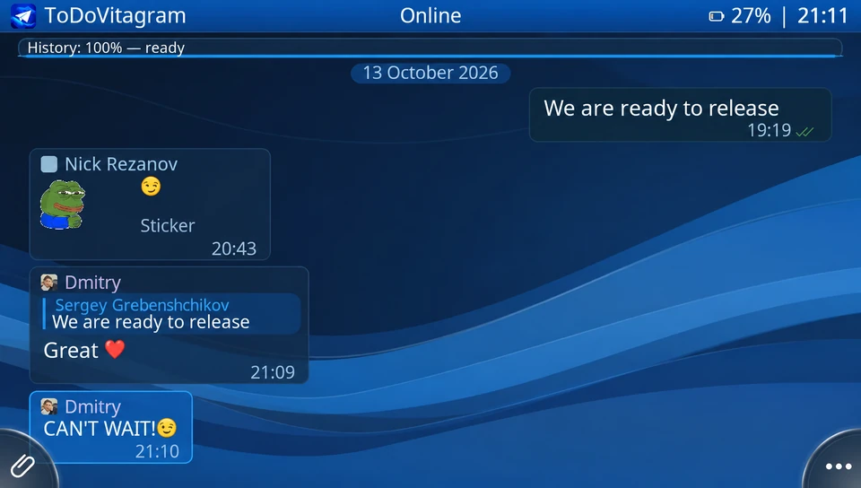
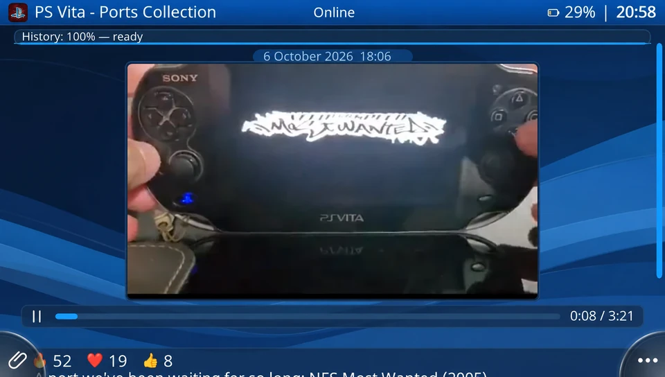
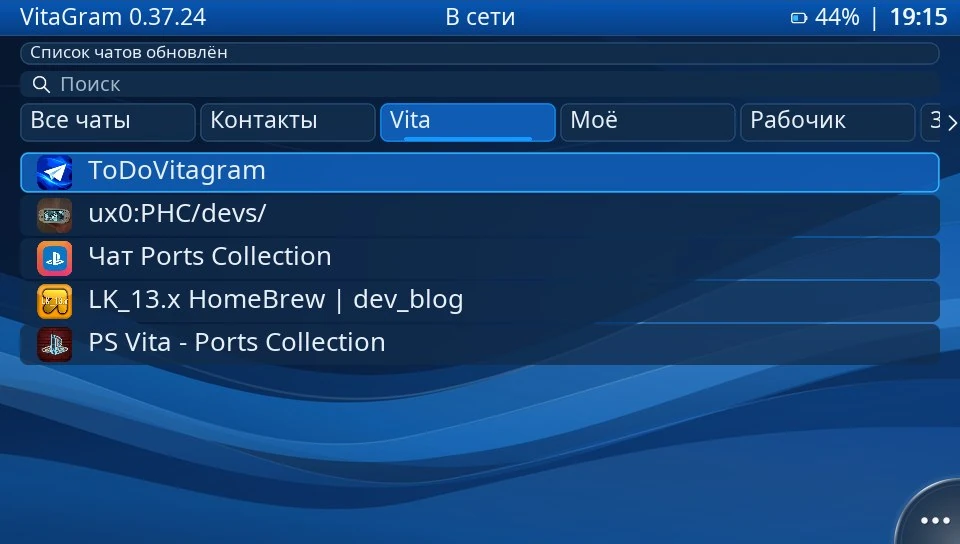
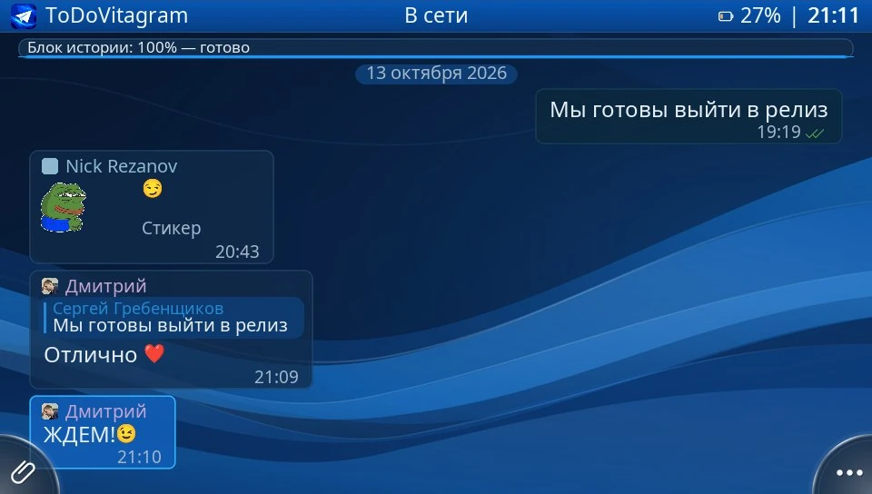

# VitaGram


**Telegram for PS Vita · Telegram для PS Vita**

Current version / Текущая версия: **0.37.73**.

[English](#english) · [Русский](#russian) · [Build / Сборка](#building) · [Licenses / Лицензии](#licenses)

<a id="english"></a>

## English

VitaGram is an unofficial homebrew Telegram client for PS Vita, built with
VitaSDK, vita2d and TDLib. Use the console's buttons and touchscreen to read chats,
send messages and attachments, and record voice messages and video notes.

**VitaGram is an AI-Vibecoded project.** AI tools are used in development,
documentation and image localization, with human direction and release decisions.

The project is under active development. See [Limitations](#limitations) for
supported media and features that are not yet available.

[Releases](https://github.com/ing156/VitaGram/releases) ·
[Report a bug](https://github.com/ing156/VitaGram/issues) ·
[Native checks](tests/README.md)

### Screenshots

| Chats | Conversation | Video |
| --- | --- | --- |
|  |  |  |

*English text in these illustrations was translated from the original Russian screenshots.*

### Features

- **Chats:** private conversations, groups, channels, Telegram folders, archive,
  search, forum topics and channel comments. Chat lists, history and media are cached.
- **Messages:** text, replies, forwarding, permission-aware deletion, standard emoji
  reactions and voting in polls, including quizzes and multiple-choice polls.
- **Photos and files:** albums, attachment batches of up to 10 items, fullscreen
  photos with rotation and 1–5× zoom (touch or right stick up/down), left-stick panning
  while zoomed, and saving files to a download folder. Attachment review offers
  Add text / Edit text; the shared text is sent once as a file or album caption.
- **Stickers and GIFs:** static and animated stickers, recent/favorite/installed
  sticker sets, saved GIFs and GIF search.
- **Audio and video:** supported media playback, progressive playback while downloading,
  voice-message recording and video notes from the front or rear camera.
  Fullscreen video: Left/Right selects 10-second seek steps; holding repeats faster
  after two and four seconds. The time and cursor update while held, and releasing
  applies the target and restores the prior play/pause state. Tap or drag the
  progress track to seek, including while the controls are hidden.
- **Interface:** native Vita keyboard or the localized in-app keyboard
  (Settings → Keyboard → Keyboard type), Cyrillic and color emoji, Light/Dark/VHBB themes, font size
  and interface language settings. Hold D-pad up/down or the left stick to scroll
  lists with acceleration. Settings → Scroll speed selects Normal,
  Fast or Very fast: up to 1, 2 or 3 pages per 0.5 seconds. Normal is the default.
  Dark is the initial theme. The in-app message window supports line breaks and
  sending with Send or Start; the system keyboard remains the default.
  Hold a key for 300 ms to open alternatives, slide to a choice and release to insert.
  Square deletes before the cursor, Triangle inserts a space, and L/R move the cursor.
  Hold Square, the on-screen Delete key, or Cross on Delete to repeat deletion
  after 350 ms, then every 60 ms. Releasing or leaving the key stops it.
  With buttons, hold Cross and select with Left/Right; Circle cancels the choice.
  Russian е offers ё and 4, ь offers ъ (also in uppercase); numbers 1–0 align to ц–х.
  Comma/period beside the spacebar offer punctuation choices; ?123 shows all symbols.
  Shift applies to one entered character; double-tap within 350 ms locks Caps Lock,
  and another tap unlocks it. Messages start with a capital and capitalize after
  sentence-ending punctuation plus whitespace or a newline. Search, credentials
  and other exact-input fields do not use automatic capitalization.
  Settings → Keyboard → Input languages selects the enabled languages. The default
  is English plus the supported console language, or English alone. The language
  key cycles enabled languages on a short press. Hold it for 300 ms to choose
  from a popup carousel, slide or use Left/Right while holding Cross, then release.
  Large sets scroll at the popup edges; Circle cancels selection.
  The 15 Latin/Cyrillic profiles use language-specific
  layouts, accents and case rules. Japanese, Korean and both Chinese variants use
  the system IME for composition, preserving the current draft. The initial profile
  follows the console language when enabled; an explicit choice is remembered until
  the app closes. Input-language preferences survive restarts independently of the UI language.
  Vault passphrases always use the in-app keyboard; controller hints are placed
  directly on its keys. See [keyboard layouts](docs/keyboard-layouts.md).
- **Connection and privacy:** MTProxy, SOCKS5 and HTTP CONNECT proxies, proxy-link
  and QR import, optional data encryption and automatic screen locking.
- **Updates:** signed VPK packages from GitHub Releases, with manual and automatic
  update checks.

### Installation and first launch

You need a homebrew-enabled PS Vita with VitaShell, internet access and enough
free space for the package and cached media.

1. Download `vitagram.vpk` from a published release and copy it to the console.
2. Install the VPK through VitaShell and launch **VitaGram** from LiveArea.
3. Choose whether to encrypt local data. Keep the chosen unlock key safe.
4. Sign in with your phone number, Telegram login code and, if enabled, your
   two-step verification password. Or tap **Sign in with a QR code** (or press
   **Square**) and scan the Vita screen from Telegram on your phone:
   **Settings → Devices → Link Desktop Device**. If enabled, two-step verification
   still requires your password. The login QR uses rounded modules and a central
   paper-plane badge with High error correction.

If a proxy is needed for login, press **Start** on the authorization screen to
configure it. Select the proxy type and enter its details, then choose
**Save and apply**. A proxy link or QR import also requires this confirmation.

The interface follows the console's language, falling back to English.
Change it manually in **Start → Language**. English, Russian, German, French,
Spanish, Italian, Dutch, Portuguese (Portugal/Brazil), Swedish, Danish, Norwegian,
Finnish, Polish, Turkish, Japanese, Korean and Simplified/Traditional Chinese are
included. British English uses the English catalog. Korean and Chinese chat text
uses the corresponding font while that interface language is selected.

### Updates

**Start → Update** checks for and installs a newer release. Automatic updates
are enabled by default and begin about a minute after launch. With a Telegram
proxy enabled, only manual checking is available: updates connect to GitHub directly.

GitHub updates install only signed packages. VitaGram restarts after installation and
preserves settings and account data. If manual installation is needed, follow
the instructions shown in settings.

VPK files saved from chats can be installed directly after enabling **Settings → Allow VPK installation** (off by default). Each installation requires confirmation and a warning about console access. The saved package is kept on cancellation or failure. For a VitaGram VPK, the package is then handed directly to the separate updater: VitaGram closes, the updater installs it and launches VitaGram again. Local packages are explicitly trusted by the user; automatic GitHub updates still require release signatures. Packages are limited to 512 MiB unpacked.

### Privacy and local data

Data is stored in `ux0:data/vitagram/`. The `db/` directory contains your Telegram
session and account data; `files/` holds downloaded media. Cache retention and size
limits are configurable in settings. Do not share `db/` or delete it to clear photos.

**Start → Data encryption** protects the database, downloaded media, cache indexes
and settings with a text passphrase (at least 10 characters) or a console-button
sequence (12–32 presses). A longer passphrase offers stronger protection against
guessing. Encryption is bound to the console: copying the card to another Vita
does not unlock the vault. **A forgotten key cannot be recovered.** Resetting the
vault erases local account data and requires signing in again.

<details>
<summary>Encryption scope and limits</summary>

Encryption changes restart the app and convert existing files before Telegram
starts. Interrupted or failed conversions resume on the next launch; until
conversion finishes, some files may remain unencrypted. Auto-lock after inactivity
or sleep hides the screen and pauses playback; background work continues, and
decryption keys remain in RAM.

Downloaded files can briefly exist in plain form before sealing. Recordings,
conversion scratch files, explicit exports and diagnostic logs are outside this
protection. Encryption does not hide filenames or sizes and cannot protect data
from software controlling the running console.

While encryption is on, VitaGram also limits what the running session leaves in RAM:
freed memory blocks up to 1 MiB are zeroed, the master key is not kept after
unlocking, and session keys are stored masked. Crash dumps (`ux0:data/psp2core-*.psp2dmp`)
contain decrypted memory; VitaGram's dumps are overwritten and deleted after unlocking
unless a diagnostic log is enabled. Key-entry screens name plugins loaded into VitaGram
from `tai/config.txt` (`*ALL` or `*VITAGRM01`): they can read the key and messages.
Kernel plugins cannot be detected or stopped by the app.

Without data encryption, console-derived keys protect the database/cache and
obfuscate proxy credentials; OpenPSID is not a secret. Downloaded media remains
unencrypted. SOCKS5 and HTTP proxy credentials travel unencrypted to the proxy;
Telegram message traffic remains MTProto-encrypted.

</details>

Diagnostic logs are **off by default**. Enable individual logs in
**Start → Diagnostic logs**. Review logs before sharing; report the app version,
steps to reproduce, media type and any on-screen error without including credentials
or account files. **Settings → About** contains project links and privacy notes.

### Limitations

- Media support is bounded by codecs, resolution and file size. The player supports
  H.264, VP8 and VP9; H.265/AV1 decoders are not included. Ordinary videos use the
  smallest compatible Telegram variant when available; fallback video limits are
  720p by pixel area and 128 MiB.
- Progressive audio/video can start after a readable 256 KiB prefix, but some MP4
  files need a complete download. While a video streams, seeking is limited to the
  already downloaded part; portrait-video preparation requires the completed file,
  and prepared portrait copies have additional seek restrictions.
- Calls, secret chats, group administration, paid/custom reactions, creating polls
  or editing forum topics, and searching for/installing sticker sets are not implemented.
- Presence follows Telegram privacy settings. Sticker-set and topic lists still
  need Telegram responses; cached previews do not provide fully offline menus.

---

<a id="russian"></a>

## Русский

VitaGram — неофициальный homebrew-клиент Telegram для PS Vita на VitaSDK, vita2d
и TDLib. Кнопки консоли и сенсорный экран позволяют читать чаты, отправлять
сообщения и вложения, записывать голосовые сообщения и видеокружки.

**VitaGram — AI-Вайбкод.** Инструменты искусственного интеллекта используются
при разработке, подготовке документации и переводе изображений; направление
работы и решения о выпуске задаёт человек.

Проект активно развивается. Поддержка медиа и ещё недоступные функции описаны
в разделе [«Ограничения»](#ограничения).

[Релизы](https://github.com/ing156/VitaGram/releases) ·
[Сообщить об ошибке](https://github.com/ing156/VitaGram/issues) ·
[Проверки на ПК](tests/README.md)

### Скриншоты

| Чаты | Переписка | Видео |
| --- | --- | --- |
|  |  |  |

### Возможности

- **Чаты:** личная переписка, группы, каналы, папки Telegram, архив, поиск,
  темы форумных групп и комментарии каналов. Списки чатов, история и медиа кэшируются.
- **Сообщения:** текст, ответы, пересылка, удаление с проверкой прав, обычные
  emoji-реакции и голосование в опросах, включая викторины и множественный выбор.
- **Фото и файлы:** альбомы, отправка до 10 вложений за раз, полноэкранные фото
  с поворотом и масштабом 100–500% (жестом или правым стиком вверх/вниз), перемещением
  левым стиком при увеличении, сохранение файлов в папку загрузок. Перед отправкой
  вложений пункт «Добавить текст» / «Изменить текст» открывает редактор; общий текст
  отправляется один раз как подпись к файлу или альбому.
- **Стикеры и GIF:** статичные и анимированные стикеры, недавние, избранные
  и установленные наборы, сохранённые GIF и поиск анимаций.
- **Аудио и видео:** воспроизведение поддерживаемых медиа, просмотр во время
  загрузки, запись голоса и видеокружков с фронтальной или задней камеры.
- **Интерфейс:** системная клавиатура Vita или локализованная встроенная клавиатура
  («Настройки → Клавиатура»), кириллица и цветные emoji, темы Светлая/Тёмная/VHBB,
  настройка размера шрифта и языка. Удержание стрелок вверх/вниз или левого стика прокручивает списки с ускорением. «Настройки → Скорость прокрутки»:
  «Норма», «Быстрая» и «Очень быстрая» — до 1, 2 и 3 страниц за 0,5 секунды.
  По умолчанию выбрана «Норма», тема тёмная. Встроенное окно сообщения поддерживает
  переносы строк и отправку кнопкой «Отправить» или Start.
  По умолчанию клавиатура системная. Удержание клавиши 300 мс открывает варианты:
  сдвиньте палец к нужному и отпустите. □ удаляет символ перед курсором,
  △ вставляет пробел, L/R перемещают курсор. Удержание □, экранной клавиши
  удаления или × на ней повторяет удаление через 350 мс, затем каждые 60 мс.
  Отпускание или уход с клавиши прекращает удаление. На кнопках — удерживайте × и выбирайте
  стрелками влево/вправо; ○ отменяет выбор. У «е» доступны «ё» и «4», у «ь» — «ъ»,
  в том числе в верхнем регистре. Цифры 1–0 расположены на «ц»–«х».
  Запятая и точка рядом с пробелом также предлагают варианты; все символы — в ?123.
  Shift действует на один введённый символ; двойное нажатие за 350 мс включает
  Caps Lock, следующее отключает. В сообщениях заглавная буква ставится в начале,
  после конца предложения с пробелом и после переноса строки. Поиск, пароли и
  остальные поля точного ввода используют ручной регистр.
  В «Настройки → Клавиатура» выбираются тип клавиатуры и языки ввода. По умолчанию
  включены английский и поддерживаемый язык системы, иначе — только английский.
  Короткое нажатие клавиши языка переключает на следующий включённый язык.
  Удержание 300 мс открывает карусель: сдвиньте палец или выбирайте стрелками
  влево/вправо при зажатой ×, затем отпустите; ○ отменяет выбор. Длинный список
  прокручивается у краёв панели. Для 15 языков на латинице и кириллице доступны
  свои раскладки, диакритика и правила регистра. Японский, корейский и оба китайских
  варианта используют системный ввод с сохранением набранного текста. Начальная
  раскладка соответствует языку системы, если он включён; ручной выбор запоминается
  до закрытия приложения. Список языков сохраняется между запусками независимо от языка интерфейса.
  Пароли хранилища всегда вводятся встроенной клавиатурой; подсказки управления
  расположены прямо на её клавишах. [Список раскладок](docs/keyboard-layouts.md).
- **Подключение и приватность:** MTProxy, SOCKS5 и HTTP CONNECT, импорт прокси
  по ссылке и QR-коду, необязательное шифрование данных и автоблокировка экрана.
- **Обновления:** подписанные VPK из GitHub Releases, ручная и автоматическая проверка.

### Установка и первый запуск

Нужны PS Vita с поддержкой homebrew и VitaShell, доступ в интернет и свободное
место для пакета и медиакэша.

1. Скачайте `vitagram.vpk` из опубликованного релиза и перенесите на консоль.
2. Установите VPK через VitaShell и запустите **VitaGram** из LiveArea.
3. Выберите, шифровать ли локальные данные. Сохраните выбранный ключ разблокировки.
4. Войдите по номеру телефона, коду Telegram и, если включён, паролю двухэтапной
   аутентификации. Или нажмите **«Войти по QR-коду»** на экране (либо кнопку
   **□**) и отсканируйте экран Vita с телефона в Telegram:
   **Настройки → Устройства → Подключить устройство**. Если включена двухэтапная
   проверка, затем потребуется её пароль. QR для входа имеет скруглённый узор
   и значок самолётика в центре; используется высокий уровень коррекции ошибок.

Если для входа нужен прокси, нажмите **Start** на экране авторизации.
Выберите тип, заполните данные и нажмите **«Сохранить и применить»**.
Импорт по ссылке или QR-коду тоже требует этого подтверждения.

Язык интерфейса выбирается по языку консоли; если каталога нет, используется
английский. Ручной выбор — **Start → Язык**. Включены английский, русский,
немецкий, французский, испанский, итальянский, нидерландский, португальский
(Португалия/Бразилия), шведский, датский, норвежский, финский, польский, турецкий,
японский, корейский, упрощённый и традиционный китайский. Британский английский
использует английский каталог. Корейский и китайский текст в чатах использует
соответствующий шрифт при выборе этого языка интерфейса.

### Обновления

**Start → Обновление** проверяет и устанавливает новый релиз. Автоматическое
обновление включено по умолчанию и начинается примерно через минуту после запуска.
При включённом прокси Telegram доступна только ручная проверка: обновления
подключаются к GitHub напрямую.

При обновлении с GitHub устанавливаются только подписанные пакеты. После установки VitaGram перезапускается;
настройки и данные аккаунта сохраняются. Если нужна ручная установка, следуйте
инструкции в настройках.

VPK из чатов можно устанавливать после включения **Настройки → Разрешить установку VPK** (по умолчанию выключено). Перед каждой установкой появляются подтверждение и предупреждение о доступе к консоли. При отмене или ошибке скачанный файл сохраняется. VPK самого VitaGram затем передаётся отдельному установщику без дополнительного вопроса о закрытии: клиент закрывается, установщик заменяет приложение и запускает его снова. Доверие к локальному пакету подтверждает пользователь; автоматические обновления с GitHub по-прежнему требуют подписи релиза. Поддерживаются пакеты размером до 512 МиБ после распаковки.

### Приватность и локальные данные

Данные находятся в `ux0:data/vitagram/`. Каталог `db/` содержит сессию Telegram
и данные аккаунта, `files/` — загруженные медиа. Срок хранения и размер кэша
задаются в настройках. Не публикуйте `db/` и не удаляйте его ради очистки фото.

**Start → Шифрование данных** защищает базу, загруженные медиа, индексы кэша
и настройки текстовой фразой (от 10 символов) или последовательностью кнопок
(12–32 нажатия). Длинная фраза устойчивее к перебору. Шифрование привязано
к консоли: перенос карты на другую Vita не разблокирует хранилище.
**Забытый ключ восстановить нельзя.** Сброс хранилища удаляет локальные данные
аккаунта и требует повторного входа.

<details>
<summary>Что защищает шифрование и каковы его ограничения</summary>

Изменение режима шифрования перезапускает приложение и преобразует существующие
файлы до подключения Telegram. Прерванное или неудачное преобразование продолжится
при следующем запуске; до завершения часть файлов может оставаться открытой.
Автоблокировка после бездействия или сна закрывает экран и ставит воспроизведение
на паузу; фоновые операции продолжаются, ключи остаются в оперативной памяти.

Загружаемые файлы кратковременно существуют открытыми до шифрования. Записи,
временные файлы конвертации, явный экспорт и диагностические журналы не защищены
этим режимом. Шифрование не скрывает имена и размеры файлов и не защищает от
программ, контролирующих работающую консоль.

При включённом шифровании VitaGram также сокращает следы сеанса в оперативной памяти:
освобождаемые блоки памяти до 1 МиБ обнуляются, мастер-ключ после разблокировки
не хранится, а сеансовые ключи хранятся в маскированном виде. Дампы падений
(`ux0:data/psp2core-*.psp2dmp`) содержат расшифрованную память; дампы VitaGram
перезаписываются и удаляются после разблокировки, если не включён диагностический журнал.
Экраны ввода ключа показывают плагины, загруженные в VitaGram из `tai/config.txt`
(`*ALL` или `*VITAGRM01`): они могут прочитать ключ и сообщения. Плагины ядра
приложение обнаружить и остановить не может.

Без шифрования данных ключи на основе идентификатора консоли защищают базу/кэши
и обфусцируют реквизиты прокси; OpenPSID не является секретом. Загруженные медиа
остаются открытыми. Логин и пароль SOCKS5/HTTP передаются прокси без шифрования;
сообщения Telegram остаются зашифрованными MTProto.

</details>

Диагностические журналы **выключены по умолчанию**. Отдельные журналы включаются
в **Start → Журналы диагностики**. Перед отправкой просмотрите содержимое; в отчёте
укажите версию, шаги воспроизведения, тип медиа и ошибку на экране, исключив
реквизиты и файлы аккаунта. **Настройки → О проекте** содержит ссылки и сведения
о приватности.

### Ограничения

- Поддержка медиа зависит от кодека, разрешения и размера. Есть H.264, VP8 и VP9;
  декодеры H.265/AV1 не включены. Для обычных видео выбирается минимальный совместимый
  вариант Telegram; при его отсутствии действуют лимиты исходника: 720p по площади
  кадра и 128 МиБ.
- Просмотр видео/аудио может начаться после непрерывных 256 КиБ от начала файла,
  но некоторым MP4 нужна полная загрузка. Во время потокового просмотра перемотка
  доступна в пределах уже загруженной части; подготовка вертикального видео требует
  докачки, у подготовленных вертикальных копий есть дополнительные ограничения перемотки.
- В полноэкранном видео влево/вправо выбирает позицию с шагом 10 секунд. Удержание
  ускоряет повтор через 2 и 4 секунды. Отметка и время обновляются при удержании,
  переход выполняется после отпускания с сохранением прежнего режима воспроизведения.
  Касание или перетаскивание по шкале тоже перематывает, даже если панель скрыта.
- Не реализованы звонки, секретные чаты, управление группами, платные/пользовательские
  реакции, создание опросов, редактирование тем форума, поиск и установка наборов стикеров.
- Статусы присутствия зависят от приватности Telegram. Списки наборов стикеров
  и тем требуют ответа сервера; кэш миниатюр не делает эти меню полностью офлайн.

---

<a id="building"></a>

## Build / Сборка

Build on Linux or WSL with VitaSDK and its ARM toolchain, CMake (3.16+), Make,
Git, curl, archive tools, a host C/C++ compiler, `gperf` and Python 3.
Vita libraries: vita2d, zlib, libpng, libjpeg, libwebp, FreeType and bzip2.

Сборка выполняется в Linux или WSL. Нужны VitaSDK с ARM toolchain, CMake (3.16+),
Make, Git, curl, средства распаковки, компилятор C/C++ для ПК, `gperf` и Python 3.
Библиотеки для Vita: vita2d, zlib, libpng, libjpeg, libwebp, FreeType и bzip2.

### 1. Checkout and API credentials / Исходники и реквизиты API

Clone with submodules, or initialize them in an existing checkout. TDLib, Jansson
and rlottie are pinned to tested revisions. Build scripts apply the Vita patches;
preserve local dependency changes before updating them.

Клонируйте с подмодулями или инициализируйте их в существующей копии. TDLib,
Jansson и rlottie закреплены на проверенных коммитах; Vita-патчи накладываются
скриптами сборки. Перед обновлением зависимостей сохраните локальные изменения.

```bash
git clone --recurse-submodules https://github.com/ing156/VitaGram.git
cd VitaGram
# For an existing checkout / Для существующей копии:
git submodule update --init
cp -n src/config.local.h.example src/config.local.h
```

Get your own `VITAGRAM_API_ID` and `VITAGRAM_API_HASH` from API development tools
at my.telegram.org and fill them in `src/config.local.h`. `src/config.h` includes
that file; `.gitignore` excludes it. Keep the placeholder example in Git.
Removing credentials from current files does not remove them from Git history.

Получите свои `VITAGRAM_API_ID` и `VITAGRAM_API_HASH` в API development tools
на my.telegram.org и заполните `src/config.local.h`. Он подключается из
`src/config.h` и исключён через `.gitignore`; в Git остаётся шаблон с заглушками.
Удаление реквизитов из текущих файлов не удаляет их из истории Git.

### 2. Prepare dependencies / Подготовка зависимостей

Run from the project root / Выполните из корня проекта:

```bash
export VITASDK=/usr/local/vitasdk
export PATH="$VITASDK/bin:$PATH"

bash scripts/fetch-emoji-font.sh
bash scripts/fetch-fallback-fonts.sh
bash scripts/fetch-ca-bundle.sh
bash scripts/build-openssl.sh
bash scripts/prepare-tdlib.sh
bash scripts/shrink-fonts.sh
bash scripts/build-ffmpeg-vita.sh
bash scripts/build-sticker-renderer.sh
```

| Component / Компонент | Install directory / Каталог установки |
| --- | --- |
| OpenSSL 3.5.9 | `external/openssl-vita/install` |
| FFmpeg 7.1.5 | `external/ffmpeg-vita71/install` |
| rlottie | `external/rlottie-vita/install` |
| Font tools / Инструменты шрифтов | `external/font-tools-venv` |

OpenSSL and FFmpeg scripts verify pinned archive hashes and apply Vita patches
without replacing SDK libraries. `prepare-tdlib.sh` builds host generators and
writes TL/MIME sources. rlottie enables TGS animations; without it, sticker
support is reduced. `shrink-fonts.sh` creates smaller packaged font copies and
keeps the originals.

Скрипты OpenSSL и FFmpeg сверяют закреплённые хэши архивов и накладывают Vita-патчи,
не заменяя библиотеки SDK. `prepare-tdlib.sh` собирает генераторы для ПК и создаёт
исходники TL/MIME. rlottie нужен для TGS-анимаций; без него поддержка стикеров
ограничена. `shrink-fonts.sh` создаёт уменьшенные копии шрифтов, сохраняя оригиналы.

Jansson is built during CMake configuration. Fonts, CA certificates, UI assets and
license notices are packaged in the VPK. Rerun TDLib preparation when its submodule
changes and CMake configuration after adding rlottie or reduced fonts.

Jansson собирается при конфигурации CMake. Шрифты, сертификаты, оформление
и лицензии входят в VPK. При смене коммита TDLib повторите подготовку генераторов;
после добавления rlottie или уменьшенных шрифтов — конфигурацию CMake.

### 3. Configure and build / Конфигурация и сборка

```bash
cmake -S . -B build-modern \
  -DCMAKE_BUILD_TYPE=Release \
  -DCMAKE_POLICY_VERSION_MINIMUM=3.5 \
  -DTD_ENABLE_TESTS=OFF

cmake --build build-modern --parallel "$(nproc)"
```

**Output / Результат: `build-modern/vitagram.vpk`.**
For ordinary client changes, only the build command is needed.
После обычных изменений клиента достаточно команды сборки.

<details>
<summary>Troubleshooting / Типичные ошибки</summary>

- **Compatibility with CMake &lt; 3.5 has been removed:** configure with
  `-DCMAKE_POLICY_VERSION_MINIMUM=3.5` / передайте этот параметр при конфигурации.
- **VitaSDK libwebp is required:** install Vita headers/libraries, rather than host
  packages / нужны заголовки и библиотеки для Vita.
- **Undefined reference to BZ2_…:** check Vita bzip2 / проверьте bzip2 для Vita.
- **Missing generated TDLib sources:** run `bash scripts/prepare-tdlib.sh` / выполните подготовку TDLib.
- **rlottie patch failure:** inspect script output and preserve local changes;
  avoid resetting dependencies blindly / проверьте вывод и сохраните локальные изменения.
- **UPDATE_APP_TO_LOGIN:** use the prepared modern TDLib / используйте подготовленную современную TDLib.

</details>

### Checks / Проверки

Native regression commands and their requirements are listed in
[tests/README.md](tests/README.md). Hardware tests must separately cover login,
sending, media playback, cameras, microphone, UI and update installation.

Команды проверок на ПК и зависимости описаны в [tests/README.md](tests/README.md).
На PS Vita отдельно проверьте вход, отправку, воспроизведение, камеры, микрофон,
интерфейс и установку обновления.

Release signing and publication instructions: [RELEASING.md](RELEASING.md).
Инструкции подписи и публикации релиза: [RELEASING.md](RELEASING.md).

### Contributing / Участие в разработке

Translations live in `assets/lang/<code>.lang`; start from `en.lang`. Preserve
`{cross}`, `{circle}`, other button tokens and `{0}`, `{1}` placeholders.
New keys must be added to every catalog; run `bash tests/run-i18n-tests.sh`.
English and Russian are reference catalogs. Portuguese (Portugal) and Traditional
Chinese translations would benefit from native review.

Переводы находятся в `assets/lang/<код>.lang`; за основу берите `en.lang`.
Сохраняйте токены кнопок и подстановки. Новые ключи добавляйте во все каталоги,
проверяйте через `bash tests/run-i18n-tests.sh`. Английский и русский — основные
каталоги. Португальский (Португалия) и традиционный китайский требуют проверки носителями.

The main UI is in `src/main.cpp`, Telegram integration in `src/telegram_client.*`,
media playback in `src/animation_player.*` and `src/voice_player.*`, caching in
`src/ui_cache.*` and `src/media_cache.*`, encryption in `src/vault*`, and localization
in `src/i18n.*`. UI assets live in `assets/VitaGram_UI_Assets_v1`; only the active
theme is loaded. `-DVITAGRAM_UI_ALT_BACKGROUND=ON` selects the stronger wave background.

Основной интерфейс — `src/main.cpp`, Telegram — `src/telegram_client.*`, плееры —
`src/animation_player.*` и `src/voice_player.*`, кэши — `src/ui_cache.*` и
`src/media_cache.*`, шифрование — `src/vault*`, локализация — `src/i18n.*`.
Оформление находится в `assets/VitaGram_UI_Assets_v1`; загружается активная тема.
Флаг `-DVITAGRAM_UI_ALT_BACKGROUND=ON` включает более контрастные волнообразные обои.

<details>
<summary>Encryption and media implementation / Реализация шифрования и медиа</summary>

**English**

- The vault derives keys with scrypt (N=2¹⁴, r=8, p=2), binds them to OpenPSID with
  HKDF-SHA256, wraps a random 256-bit master key and seals files with
  ChaCha20-Poly1305 in authenticated 64 KiB chunks. TDLib uses a separate database
  subkey. Vault state is authenticated with HMAC-SHA256. Tests cover RFC vectors
  and comparison with OpenSSL; see `tests/run-vault-tests.sh`.
- Screen locking retains keys for background work. Files decrypt in memory for
  playback; completed downloads are sealed by the background worker. Plaintext
  migration failures are reported rather than treated as completed encryption.
- TGS input is bounded and checked before rlottie parsing; rlottie's embedded
  image loader is disabled. Proxy DNS-over-HTTPS verifies the packaged CA bundle;
  ordinary DNS remains a fallback. The updater verifies TLS certificates as well
  as the package signature.
- Video notes target 240×240 at 30 FPS, H.264 + mono AAC in MP4. Encoding follows
  recording; one minute can require about 157 MB of temporary camera/audio data.
  These targets and performance need physical-device testing.

**Русский**

- Хранилище использует scrypt (N=2¹⁴, r=8, p=2), привязку к OpenPSID через
  HKDF-SHA256, случайный мастер-ключ 256 бит и ChaCha20-Poly1305 с аутентифицированными
  блоками по 64 КиБ. У базы TDLib отдельный подключ; состояние подписано HMAC-SHA256.
  Проверки по RFC и OpenSSL — в `tests/run-vault-tests.sh`.
- Блокировка экрана сохраняет ключи для фоновой работы. Файлы расшифровываются
  в памяти; завершённые загрузки шифруются фоновым потоком. Ошибки преобразования
  показываются пользователю и не считаются завершённым шифрованием.
- TGS проверяются до разбора в rlottie; встроенный загрузчик картинок отключён.
  DNS-over-HTTPS для прокси проверяет сертификаты по упакованному CA bundle,
  обычный DNS остаётся запасным вариантом. Обновление проверяет TLS и подпись пакета.
- Видеокружки: целевые 240×240, 30 FPS, H.264 и моно AAC в MP4. Кодирование выполняется
  после записи; минута может требовать около 157 МБ временных кадров и звука.
  Частоту кадров и производительность нужно проверять на устройстве.

</details>

---

<a id="licenses"></a>

## Licenses / Лицензии

VitaGram's own source code is licensed under [MIT](LICENSE). Third-party code,
fonts and adapted artwork keep their original licenses. AI assistance does not
change those licenses or the attribution requirements.

Собственный код VitaGram распространяется по [MIT](LICENSE). Сторонний код,
шрифты и адаптированная графика сохраняют исходные лицензии. Использование AI
не меняет лицензии и требования к указанию авторства.

| Component / Компонент | License / Лицензия |
| --- | --- |
| TDLib and the tdlib-vita port / TDLib и порт tdlib-vita | [Boost Software License 1.0](external/tdlib-upstream/LICENSE_1_0.txt) |
| SQLCipher bundled with TDLib / SQLCipher в TDLib | [BSD-3-Clause](external/tdlib-upstream/sqlite/sqlite/LICENSE); SQLite core is [public domain](https://www.sqlite.org/copyright.html) / ядро SQLite — общественное достояние |
| vita2d | [MIT](assets/vita2d-LICENSE.txt) |
| Jansson | [MIT](external/jansson/LICENSE) |
| OpenSSL | [Apache-2.0](https://github.com/openssl/openssl/blob/openssl-3.5.9/LICENSE.txt) |
| FFmpeg with the Vita decoder / FFmpeg с Vita-декодером | [LGPL-2.1-or-later](https://ffmpeg.org/legal.html), for the configured build / для используемой конфигурации |
| rlottie | [MIT and component licenses](external/rlottie-vita/source/COPYING): [MPL-2.0](external/rlottie-vita/source/licenses/COPYING.MPL), [BSD-3-Clause](external/rlottie-vita/source/licenses/COPYING.SKIA), [FTL](external/rlottie-vita/source/licenses/COPYING.FTL), [Pixman](external/rlottie-vita/source/licenses/COPYING.PIX), [RapidJSON](external/rlottie-vita/source/licenses/COPYING.RPD) and [stb](external/rlottie-vita/source/licenses/COPYING.STB) notices |
| FreeType | [FTL or GPL-2.0](https://freetype.org/license.html); the FTL option is used for attribution here / здесь указано авторство по FTL |
| Noto fonts, including CJK and emoji / Шрифты Noto, включая CJK и emoji | [SIL Open Font License 1.1](assets/NotoSans-LICENSE.txt); additional family notices in `assets/*-LICENSE.txt` / уведомления семейств в `assets/*-LICENSE.txt` |
| zlib | [Zlib](https://zlib.net/zlib_license.html) |
| libpng | [PNG Reference Library License v2](https://github.com/pnggroup/libpng/blob/libpng16/LICENSE) for the installed SDK version / для установленной версии SDK |
| libjpeg-turbo / JPEG | [IJG and BSD-style component licenses](https://github.com/libjpeg-turbo/libjpeg-turbo/blob/main/LICENSE.md), including Zlib / включая Zlib |
| libwebp | [BSD-3-Clause](https://github.com/webmproject/libwebp/blob/main/COPYING) |
| bzip2 / libbzip2 | [bzip2-1.0.6 license](https://sourceware.org/bzip2/manual/manual.html), also used by 1.0.8 / также применяется в 1.0.8 |
| minih264 | [CC0-1.0](external/minih264/LICENSE) |
| quirc | [ISC](external/quirc/LICENSE) |
| Mozilla CA certificate bundle supplied by curl / Сертификаты Mozilla из curl | [MPL-2.0](https://curl.se/docs/caextract.html#license) |
| Adapted VHBB panels and header / Панели и шапка VHBB | [CC BY-NC-SA 4.0](assets/VitaGram_UI_Assets_v1/themes/vhbb/LICENSE.txt), with [attribution and changes](assets/VitaGram_UI_Assets_v1/themes/vhbb/NOTICE.txt) |
| VitaSDK C/C++ runtime / Среда исполнения C/C++ VitaSDK | [newlib component licenses](https://github.com/vitasdk/newlib/blob/vita/COPYING.NEWLIB); [libstdc++ GPLv3 with GCC Runtime Library Exception 3.1](https://gcc.gnu.org/onlinedocs/libstdc++/manual/license.html) |

The FFmpeg build has GPL, version-3 and nonfree features disabled. The TDLib
SQLite tree contains SQLCipher code, so its BSD notice must be retained in
addition to recognizing SQLite's public-domain core. rlottie's MPL-2.0 notice
covers its interpolator; a blanket MIT label would be incomplete.

Сборка FFmpeg отключает GPL, version-3 и nonfree-компоненты. В дереве SQLite
из TDLib есть код SQLCipher: нужно сохранять его BSD-уведомление, несмотря
на статус общественного достояния ядра SQLite. У rlottie интерполятор под MPL-2.0;
обозначение всей библиотеки как MIT было бы неполным.

The code's MIT license does not grant unrestricted rights to VHBB artwork.
Those adapted assets require attribution, noncommercial use and the same license
for adaptations, as described by [Creative Commons](https://creativecommons.org/licenses/by-nc-sa/4.0/).
Screenshots can contain third-party names, avatars, stickers, logos and media;
these are not relicensed as VitaGram source code.

MIT для кода не даёт неограниченных прав на графику VHBB. Адаптированные ресурсы
требуют указания авторства, некоммерческого использования и той же лицензии
для производных работ; условия описаны у [Creative Commons](https://creativecommons.org/licenses/by-nc-sa/4.0/).
Имена, аватары, стикеры, логотипы и медиа на скриншотах не становятся частью
собственного кода VitaGram под MIT.

The current VPK recipe includes the project's license and notices for TDLib,
vita2d, Jansson, OpenSSL, FFmpeg, rlottie (when enabled), Noto, minih264, quirc
and VHBB under `app0:assets/` and `app0:ui/themes/vhbb/`. Packaging is not yet a
complete license-notice inventory: see [release checks](RELEASING.md#license-notices--лицензионные-уведомления).
**Settings → About** also lists third-party licenses.

Текущая конфигурация VPK включает лицензию проекта и уведомления TDLib, vita2d,
Jansson, OpenSSL, FFmpeg, rlottie (если включён), Noto, minih264, quirc и VHBB
в `app0:assets/` и `app0:ui/themes/vhbb/`. Перечень упакованных уведомлений пока
неполный; подробности — в [проверках релиза](RELEASING.md#license-notices--лицензионные-уведомления).
Лицензии зависимостей также перечислены в **Настройки → О проекте**.

### Acknowledgements / Благодарности

VitaGram builds on the work of these authors and communities. Thank you to every
upstream author, maintainer and contributor, including those named in the linked
license and AUTHORS files.

VitaGram основан на работе этих авторов и сообществ. Спасибо всем разработчикам,
сопровождающим и участникам, в том числе перечисленным в лицензиях и файлах AUTHORS.

- **[Vladislav Atamanenko / Владислав Атаманенко](https://github.com/v-atamanenko)** —
  [tdlib-vita](https://github.com/v-atamanenko/tdlib-vita), the first TDLib port
  for PS Vita and the basis for the POSIX compatibility layer / первый порт TDLib
  на Vita и основа слоя совместимости POSIX.
- **[VitaSDK](https://github.com/vitasdk), GCC and newlib contributors / участники GCC и newlib** —
  the toolchain, runtime and platform headers / инструменты сборки, среда исполнения и заголовки платформы.
- **[Sergi Granell (xerpi)](https://github.com/xerpi/libvita2d) and vita2d contributors / участники vita2d** —
  2D rendering / двумерная отрисовка.
- **[Telegram and TDLib contributors](https://github.com/tdlib/td), [SQLite](https://www.sqlite.org/) and [Zetetic / SQLCipher](https://github.com/sqlcipher/sqlcipher)** —
  Telegram integration and local databases / подключение Telegram и локальные базы.
- **[Petri Lehtinen and Jansson contributors](https://github.com/akheron/jansson)** —
  JSON parsing / разбор JSON.
- **[OpenSSL](https://github.com/openssl/openssl), [FFmpeg](https://ffmpeg.org/), [fish47 / FFmpeg-vita](https://github.com/fish47/FFmpeg-vita) and [MakiseKurisu](https://github.com/MakiseKurisu/vita-sceVideodecInitLibrary-test)** —
  cryptography, media and Vita hardware-decoder work / криптография, медиа и аппаратное декодирование Vita.
- **[Samsung and the rlottie authors](external/rlottie-vita/source/AUTHORS)**,
  including Subhransu Mohanty and Hermet Park, and the Skia, Pixman, RapidJSON,
  stb and Mozilla contributors — animation and rendering components / анимация и компоненты отрисовки.
- **[The FreeType Project](https://freetype.org/)**, including David Turner,
  Robert Wilhelm and Werner Lemberg, and **[Noto contributors](https://github.com/notofonts)** —
  font rendering, multilingual typefaces and emoji / отрисовка шрифтов, поддержка языков и emoji.
- **[Jean-loup Gailly and Mark Adler / zlib](https://zlib.net/)**,
  **[libpng authors](https://github.com/pnggroup/libpng)** (Guy Eric Schalnat,
  Andreas Dilger, Glenn Randers-Pehrson and Cosmin Truta),
  **[Independent JPEG Group and libjpeg-turbo contributors](https://github.com/libjpeg-turbo/libjpeg-turbo)**,
  **[Google and libwebp contributors](https://github.com/webmproject/libwebp)**,
  and **[Julian Seward and bzip2 contributors](https://sourceware.org/bzip2/)** —
  image decoding and compression / декодирование изображений и сжатие.
- **[lieff / minih264](https://github.com/lieff/minih264)** and
  **[Daniel Beer / quirc](https://github.com/dlbeer/quirc)** — H.264 encoding and
  QR recognition / кодирование H.264 и распознавание QR.
- **[Mozilla](https://www.mozilla.org/) and [Daniel Stenberg / curl contributors](https://curl.se/docs/caextract.html)** —
  the CA certificate store and its PEM distribution / корневые сертификаты и их распространение в PEM.
- **[devnoname120 and VHBB contributors](https://github.com/devnoname120/vhbb)** —
  the artwork adapted for the VHBB theme / графика для адаптированной темы VHBB.
- **[TheOfficialFloW / VitaShell](https://github.com/TheOfficialFloW/VitaShell)** and
  **[VegettoSan / PSVitaAlive](https://github.com/VegettoSan/PSVitaAlive)** —
  examples of Vita package installation and update lifecycle / примеры установки пакетов и самообновления Vita.

Thanks also to the PS Vita homebrew community, testers, translators and everyone
who reports problems or contributes improvements. Credits acknowledge their work
and do not imply endorsement of VitaGram.

Также спасибо сообществу homebrew PS Vita, тестировщикам, переводчикам и всем,
кто сообщает об ошибках и помогает улучшать проект. Благодарность не означает
официального одобрения VitaGram перечисленными авторами.
