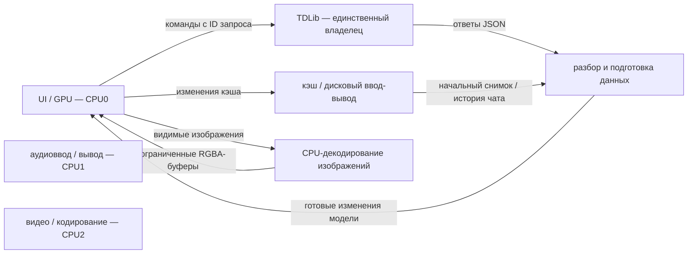

# Запуск, загрузка чатов и распараллеливание VitaGram

Анализ исходников рабочего дерева 0.31.2, 27 сентября 2026 года. Это анализ путей выполнения, а не замеры скорости на PS Vita. Проценты ускорения и время запуска до измерений на устройстве неизвестны. Изменения обработки отправок в рабочем дереве рассматриваются отдельно от предлагаемой перестройки запуска.

## Основные выводы

1. Запуск сети/TDLib сейчас не перекрывается с восстановлением кэша. Пользователь ждёт последовательного выполнения нескольких независимых этапов.
2. JSON разбирается отдельным потоком, но дальнейшая обработка, проверки файлов, обновление модели и декодирование статических изображений по-прежнему задерживают главный поток.
3. История набирается последовательными маленькими страницами: первая — 5 сообщений, следующие — 10, цель — 60. Задержка каждого ответа складывается с остальными.
4. Дополнительные потоки сами по себе не ускорят сеть: Vita-сборка TDLib использует один планировщик, который обслуживается вызовами `receive()`.
5. Важнее обеспечить регулярное обслуживание сети, уменьшить объём повторной работы и разделить владение данными. Увеличение размера пакета запросов не равно увеличению числа одновременно работающих потоков.

## Где сейчас тратится время

| Участок | Подтверждено кодом | Следствие / направление оптимизации |
|---|---|---|
| `main.cpp`, `main()` | Шрифты → сеть → настройки → `restoreCache()` → `tg.start()` | Авторизация и синхронизация Telegram начинаются только после чтения кэша. Первым запускать транспорт после готовности сети и параметров подключения; чтение кэша выполнять независимо. |
| `media_render.cpp`, `rich_text_init()` | Проверка Noto Sans, создание шрифта и открытие Emoji выполняются до запуска TDLib | Нужно измерить каждый этап. GPU/шрифтовые объекты оставлять на UI; подготовку данных можно перекрывать с сетью. Нельзя считать размер файла шрифта временем его полного чтения: FreeType может читать лениво. |
| `telegram_client.cpp`, `restoreCache()` | Загружаются два индекса; `snapshot()` глубоко копирует весь UI-кэш, включая истории; затем используются пользователи, чаты, папки и стикеры | Сделать отдельный снимок данных стартового экрана; историю конкретного чата загружать по запросу. Сейчас UI-кэш ограничен 8 МиБ, медиаиндекс — 4 МиБ; это пределы файлов, а не фактическое потребление RAM. |
| `media_cache.cpp`, `resolve()/walk()` | Рекурсивный обход JSON и `stat()` выполняются при обработке ответа, под mutex индекса | На старте/при медианасыщенной истории много синхронных обращений к накопителю. Проверять только нужные экрану файлы; хранить краткоживущий результат проверки с инвалидированием после очистки, удаления и ошибок открытия. |
| `main.cpp`, `TextureCache::loadOne()` | Один JPEG/PNG/WebP декодируется синхронно, вместе с созданием текстуры и ожиданием GPU | Ограничение «одна картинка за кадр» не ограничивает длительность кадра. Выделить CPU-декодирование в ограниченную очередь; создание, загрузку и освобождение GPU-текстур оставить UI. |
| `telegram_client.cpp`, `requestHistoryPage()` | Один незавершённый запрос; `limit=5`, затем `10`; цель — 60 | При полной выдаче страниц и повторении граничного сообщения требуется около 8 последовательных ответов. Частичные ответы могут увеличить число запросов. Первая короткая страница полезна для быстрого первого текста, последующие должны быть крупнее. |
| `telegram_client.cpp`, `publishChats()` | Копируются все известные чаты выбранной папки, затем сортируются и обрезаются до окна (изначально 15) | Цена зависит от всего списка, а не 15 видимых строк. Публиковать только при изменениях списка; сортировать индексы/ID и копировать лишь видимое окно. |
| `telegram_client.cpp`, `rebuildHistory()` | Повторная сортировка и копирование накопленной истории с объединением фотоальбомов | По мере прокрутки растёт работа на каждое изменение. Обновлять затронутые строки, использовать упорядоченное добавление страниц; сохранять привязку выбора по ID и корректность смешанных альбомов. |
| `telegram_client.cpp`, `pump()` | Бюджет 2 мс проверяется после `process()`, а `publishChats()` находится за пределами этого бюджета | Отдельный тяжёлый ответ может превысить бюджет. Не называть это жёстким ограничением 2 мс. Пакетную подготовку модели делать до UI, применение крупных пакетов дробить. |
| `ui_cache.cpp`, `flush()` | Запись на диск фоновая, но глубокая копия всего кэша выполняется под mutex, который нужен UI | Фоновая запись не исключает блокировку UI. Нужен один владелец кэша с очередью изменений или независимые снимки небольших разделов. |
| `cpu_scheduler.cpp` | UI закреплён на CPU0, аудио на CPU1, видео на CPU2; сеть/парсер мигрируют между доступными ядрами | При занятых аудио/видео и недоступном CPU3 сеть может делить ядро с декодером/кодером. Приоритет и ограничение непрерывного времени работы важнее числа pthread. |

## Что уже меняется в рамках исправления отправок

В текущем рабочем дереве, независимо от будущей оптимизации запуска:

- Чтение TDLib больше не отключается при заполнении очереди ответов. Ограничивается подача новых запросов; сеть продолжает обслуживаться.
- Парсер объединяет ожидающие `updateFile` одного файла. Ответы на запросы, события сообщений и авторизации сохраняются. Новое состояние файла помещается после более ранних событий.
- Сеть и парсер получают приоритет выше тяжёлой видеообработки; после завершения захвата/воспроизведения перераспределение CPU выполняется сразу.
- События прогресса файлов больше не вызывают ненужную пересортировку списка чатов.
- Журнал отправок записывает фоновый поток. Отправки аудио и кружков имеют независимые идентификаторы и состояния.

Ограничение: объединение прогресса не устанавливает жёсткого предела памяти для всех управляющих событий. Если UI надолго перестанет обрабатывать ответы, очередь таких событий всё ещё может расти. Нельзя устранять это произвольным удалением сообщений/ответов. Для следующего этапа нужны размеры очередей в байтах, длительность задержки UI и предел числа инициируемых приложением запросов.

## Предлагаемая схема потоков

Это логические очереди, а не требование создать отдельное ядро или по потоку на каждую стрелку. Подготовку изображений и фоновое кодирование можно обслуживать ограниченным рабочим пулом с разными приоритетами. Для реального времени захвата/звука оставить отдельные потоки. CPU3 считать дополнительным ресурсом только после успешной проверки; корректность должна сохраняться на трёх доступных ядрах.

Не переносить существующие `process()`, `parseChat()` и `restoreCache()` в разные потоки без изменения владения состоянием: сейчас они меняют общие контейнеры, которые читает UI. Сначала отделить подготовку снимка от применения. Живые обновления должны иметь преимущество над более старым кэшем, особенно при параллельной авторизации и восстановлении.

Не вызывать `td_json_client_send/receive/create/destroy` из нескольких потоков: используемый Vita-порт запускает TDLib через `ConcurrentScheduler::init(0)` и обслуживает его в `receive()`. Отдельные потоки для «аудиозагрузки», «видеозагрузки» и «чата», вызывающие этот же клиент, нарушат текущую модель исполнения. Сетевые передачи TDLib могут чередоваться внутри одного обслуживаемого планировщика.

## Порядок оптимизации

1. **Измерения и отсутствие остановок сети.** Зафиксировать длительность этапов запуска, максимальную паузу обслуживания TDLib, глубину/байты очередей и длительность обработки ответа. Проверить отправку кружка + голосового + открытие другого чата одновременно и после завершения отправки.
2. **Быстрый первый экран.** После загрузки настроек подключения запустить транспорт; параллельно прочитать минимальный снимок списка чатов. Дать UI начать обработку ввода до восстановления всех историй. Сохранить корректность автономного режима и отмены запуска.
3. **История без длинной цепочки маленьких запросов.** Сохранить быструю первую страницу 5–10 сообщений; следующие запрашивать по 30–50 с ограничением подготовленного пакета. Догружать по близости к границе, а не обязательно ждать полного блока 60 для взаимодействия. Страницы одной истории зависят от курсора: не запускать их бездумно параллельно.
4. **Меньше работы на кадр.** Отдельный признак изменения списка, индекс чатов по ID, сортировка ID вместо глубоких копий, выбор верхних N; CPU-декодирование картинок в фоне с ограничением суммарных байтов буферов.
5. **Кэш без длинных блокировок.** Один владелец записи; маленькие снимки разделов; отложенная проверка файлов, разделённые индексы списка и истории. Ограничивать конкуренцию операций на карте памяти: десятки потоков чтения могут ухудшить результат.
6. **Настройка приоритетов по замерам.** Сеть работает короткими итерациями и уступает CPU; парсер — ограниченными порциями; звук имеет дедлайн; видео не должно лишать сеть процессорного времени. Увеличивать параллелизм только если измерения показывают свободный CPU и отсутствие перегрузки памяти/накопителя.

## Как проверить на устройстве

Для каждого сценария минимум 10 запусков; сравнивать медиану и p95, отдельно холодный и повторный запуск. Зафиксировать модель Vita, тип накопителя, частоты CPU/GPU, доступность CPU3, Wi-Fi и режим MTProxy.

- Пустой кэш; небольшой кэш; заполненный кэш в пределах текущих лимитов.
- Первый отображённый кадр; первый интерактивный список; готовность Telegram; первый актуальный список; первое сообщение открытого чата; завершение целевого блока истории.
- Обычный чат, форумная тема, фотоальбомы, видео и длинная история.
- Открытие чата одновременно с отправкой аудио/кружка и воспроизведением; повторное открытие после завершения отправки.
- Потеря Wi-Fi, восстановление соединения, MTProxy, отмена записи/воспроизведения, смена чата во время кодирования.

Собирать: времена этапов; p50/p95/max времени кадра и `pump/process/publishChats/rebuildHistory`; число запросов истории до первых 60 сообщений; паузы между `receive`; максимальные размеры очередей; ожидание mutex; пик RAM; скорость/задержки аудио и видео. Писать агрегаты фоново, а не синхронный лог каждого кадра. Не включать содержимое сообщений, ключи доступа или secret прокси в журнал производительности.

Критерии принятия: более ранний интерактивный список и первое сообщение без ухудшения p95 кадра; отсутствие потери/перестановки управляющих событий; сеть продолжает работать при медианагрузке; нет роста памяти после повторяющихся циклов отправки; корректное возвращение к новым сообщениям после загрузки старой истории.
